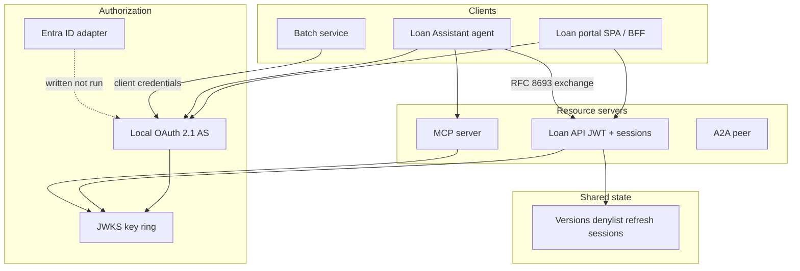

# Architecture

End-to-end auth for users and AI agents at **Northglass Financial Services** (fictional).

See [components](components/) for per-piece detail and [decision-guide.md](decision-guide.md) for when to pick JWT, sessions or opaque tokens.
