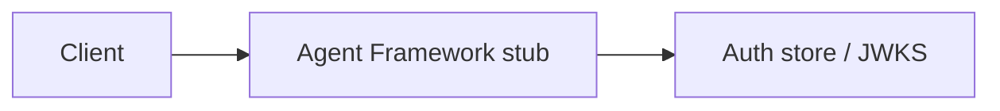

# Agent Framework stub

Deterministic offline agent Module: `src/aauth/agents.py`.

## 1. Purpose

Deterministic offline agent Built for Northglass Financial Services (fictional).

## 2. Architecture



## 3. How it works

See `src/aauth/agents.py` and the tests under `tests/`.

## 4. Key files

| File | Role |
|---|---|
| `src/aauth/agents.py` | Implementation |
| `tests/` | Behaviour and attack coverage |

## 5. Code excerpts

<!-- code: src/aauth/agents.py::run_loan_assistant -->
```python
def run_loan_assistant(
    delegation: DelegationService,
    *,
    user_token: str,
    agent: Principal,
    user_text: str,
) -> AgentResult:
    plan = plan_from_text(user_text)
    audience = COMPANY.audience_mcp
    delegated: AccessToken = delegation.exchange(
        subject_token=user_token,
        agent=agent,
        requested_scopes=["loans:read", "tools:summarize"],
        target_audience=audience,
        tool_id="summarize_loan",
    )
    exceeded = delegation.agent_exceeds_user(user_token, delegated.token, audience)
    summary = f"Agent {agent.id} summarized {plan.args['loan_id']} with scopes [{delegated.claims.get('scope')}] for audience {audience}"
    return AgentResult(
        tool=plan.tool,
        scopes_used=delegated.claims.get("scope", "").split(),
        audience=audience,
        exceeded_user=exceeded,
        summary=summary,
    )
```
<!-- /code -->

## 6. Configuration

Defaults live in the module and in `config/policy.yaml`.

## 7. Commands

```bash
aauth gate
```

## 8. Real output

<!-- output: gate -->
```text
Auth security release gate

PASS  jwks_active_key: 1 keys
PASS  attack_suite_hardened: 14/14 blocked
PASS  delegation_blocks_overreach: no_overlapping_scopes
PASS  delegation_subset: exceeded=[]
PASS  benchmark_runs: measured ok
PASS  naive_not_in_default_paths: offenders=[]

6/6 checks passed
```
<!-- /output -->

## 9. Tests and gates

Covered by pytest and `aauth gate`. CI runs both.

## 10. Guardrails

Fail closed on validation errors. Naive paths are never default.

## 11. Security and governance

Mapped in [threat-model.md](../threat-model.md). Keys are runtime-only.

## 12. Observability

Failures emit audit events; see [observability.md](../observability.md).

## 13. Failure modes

See [failure-modes.md](../failure-modes.md).

## 14. Mapping to cloud services

| Azure | Google Cloud | AWS |
|---|---|---|
| Entra ID | Identity Platform | IAM Identity Center |
| API Management | Apigee | API Gateway |
| Key Vault | Cloud KMS | KMS |
| Log Analytics | Cloud Logging | CloudWatch |

Also referenced: Entra ID, API Management, Key Vault, Log Analytics, Microsoft Fabric (N/A here), BigQuery (N/A), S3 (N/A).

## 15. Limitations

Offline demo; Entra path written not run; nothing deployed.

## 16. Interview talking points

Explain how agent framework stub fits the end-to-end agent auth story and cite a real number from `aauth benchmark` or `aauth attacks`.
