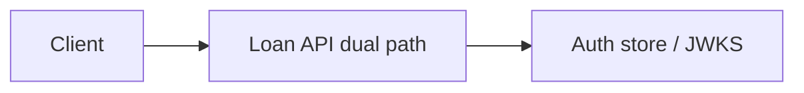

# Loan API dual path

FastAPI JWT and session routes Module: `src/aauth/api.py`.

## 1. Purpose

FastAPI JWT and session routes Built for Northglass Financial Services (fictional).

## 2. Architecture



## 3. How it works

See `src/aauth/api.py` and the tests under `tests/`.

## 4. Key files

| File | Role |
|---|---|
| `src/aauth/api.py` | Implementation |
| `tests/` | Behaviour and attack coverage |

## 5. Code excerpts

<!-- code: src/aauth/api.py::build_app -->
```python
def build_app(state: AppState | None = None) -> FastAPI:
    st = state or AppState(ring=KeyRing.create(COMPANY.issuer, seed=1), store=AuthStore.memory())
    app = FastAPI(title="Northglass Loan API", version="0.1.0")
    app.state.aauth = st

    @app.get("/health")
    def health():
        return {"ok": True, "company": COMPANY.name}

    @app.get("/.well-known/jwks.json")
    def jwks():
        return st.ring.jwks()

    # --- JWT login (demo): issues access token for a known principal ---
    @app.post("/auth/jwt/login")
    def jwt_login(body: dict):
        sub = body.get("sub")
        p = COMPANY.principals.get(sub)
        if p is None or p.kind != "user":
            st.audit.emit("login", "failure", subject=str(sub), reason="unknown_user")
            raise HTTPException(401, "invalid_credentials")
        tok = jwt_tokens.issue(st.ring, sub=p.id, audience=COMPANY.audience_api, scopes=list(p.scopes), roles=list(p.roles), store=st.store)
        st.audit.emit("token_issue", "success", subject=p.id, token_id=tok.jti, scopes=list(p.scopes))
        return {"access_token": tok.token, "token_type": "Bearer", "expires_in": 300}

    # --- Session login ---
    @app.post("/auth/session/login")
    def session_login(body: dict, response: Response):
        sub = body.get("sub")
        p = COMPANY.principals.get(sub)
        if p is None or p.kind != "user":
            st.audit.emit("login", "failure", subject=str(sub), reason="unknown_user")
            raise HTTPException(401, "invalid_credentials")
        sess = sessions.create(st.store, sub=p.id, roles=list(p.roles), scopes=list(p.scopes))
        response.set_cookie(
            key=sessions.COOKIE_NAME,
            value=sess.sid,
            httponly=True,
            secure=True,
            samesite="lax",
            max_age=sessions.IDLE_TTL,
            path="/",
        )
        st.audit.emit("login", "success", subject=p.id, meta={"sid": sess.sid[:8]})
        return {"csrf": sess.csrf, "sub": p.id}

    @app.post("/auth/session/logout")
    def session_logout(request: Request, response: Response):
        sid = request.cookies.get(sessions.COOKIE_NAME)
        if sid:
            sessions.destroy(st.store, sid)
        response.delete_cookie(sessions.COOKIE_NAME, path="/")
        return {"ok": True}

    def _jwt_principal(authorization: str | None) -> dict:
        if not authorization or not authorization.lower().startswith("bearer "):
            st.audit.emit("validate_fail", "failure", reason="missing_bearer")
            raise HTTPException(401, "missing_bearer")
        token = authorization.split(" ", 1)[1]
        try:
            return jwt_tokens.verify(token, st.ring, audience=COMPANY.audience_api, store=st.store)
        except jwt_tokens.TokenError as e:
            st.audit.emit("validate_fail", "failure", reason=e.reason)
            raise HTTPException(401, e.reason) from e

    def _session_principal(request: Request, x_csrf_token: str | None) -> sessions.Session:
        sid = request.cookies.get(sessions.COOKIE_NAME)
        if not sid:
            raise HTTPException(401, "missing_session")
        try:
            sess = sessions.load(st.store, sid)
            if request.method in ("POST", "PUT", "PATCH", "DELETE"):
                sessions.check_csrf(sess, x_csrf_token)
            return sess
        except sessions.SessionError as e:
            st.audit.emit("validate_fail", "failure", reason=e.reason)
            raise HTTPException(401, e.reason) from e

    @app.get("/jwt/loans")
    def jwt_list_loans(authorization: str | None = Header(default=None)):
        claims = _jwt_principal(authorization)
        if "loans:read" not in claims.get("scope", "").split():
            raise HTTPException(403, "insufficient_scope")
        return {"loans": list(st.loans.values()), "sub": claims["sub"]}

    @app.get("/session/loans")
    def session_list_loans(request: Request, x_csrf_token: str | None = Header(default=None)):
        sess = _session_principal(request, x_csrf_token)
        if "loans:read" not in sess.scopes:
            raise HTTPException(403, "insufficient_scope")
        return {"loans": list(st.loans.values()), "sub": sess.sub}

    @app.post("/session/loans/{loan_id}/note")
    def session_add_note(loan_id: str, body: dict, request: Request, x_csrf_token: str | None = Header(default=None)):
        sess = _session_principal(request, x_csrf_token)
        if "loans:write" not in sess.scopes:
            raise HTTPException(403, "insufficient_scope")
        if loan_id not in st.loans:
            raise HTTPException(404, "not_found")
        st.loans[loan_id].setdefault("notes", []).append({"by": sess.sub, "text": body.get("text", "")})
        return {"ok": True}

    @app.exception_handler(HTTPException)
    async def http_exc(request: Request, exc: HTTPException):
        return JSONResponse({"error": exc.detail}, status_code=exc.status_code)

    return app
```
<!-- /code -->

## 6. Configuration

Defaults live in the module and in `config/policy.yaml`.

## 7. Commands

```bash
aauth company
```

## 8. Real output

<!-- output: company -->
```text
Northglass Financial Services (northglass)
issuer: https://auth.northglass.example
principals: 8
  u-ava    user    Ava Chen             roles=loan.officer
  u-ben    user    Ben Okonkwo          roles=loan.underwriter
  u-cara   user    Cara Singh           roles=compliance.officer
  u-dev    user    Dev Patel            roles=it.admin
  a-loan   agent   Loan Assistant       roles=agent.loan_assistant
  a-docs   agent   Doc Fetcher          roles=agent.doc_fetcher
  a-risk   agent   Risk Screener        roles=agent.risk_screener
  s-apim   service APIM Gateway         roles=service.apim
```
<!-- /output -->

## 9. Tests and gates

Covered by pytest and `aauth gate`. CI runs both.

## 10. Guardrails

Fail closed on validation errors. Naive paths are never default.

## 11. Security and governance

Mapped in [threat-model.md](../threat-model.md). Keys are runtime-only.

## 12. Observability

Failures emit audit events; see [observability.md](../observability.md).

## 13. Failure modes

See [failure-modes.md](../failure-modes.md).

## 14. Mapping to cloud services

| Azure | Google Cloud | AWS |
|---|---|---|
| Entra ID | Identity Platform | IAM Identity Center |
| API Management | Apigee | API Gateway |
| Key Vault | Cloud KMS | KMS |
| Log Analytics | Cloud Logging | CloudWatch |

Also referenced: Entra ID, API Management, Key Vault, Log Analytics, Microsoft Fabric (N/A here), BigQuery (N/A), S3 (N/A).

## 15. Limitations

Offline demo; Entra path written not run; nothing deployed.

## 16. Interview talking points

Explain how loan api dual path fits the end-to-end agent auth story and cite a real number from `aauth benchmark` or `aauth attacks`.
