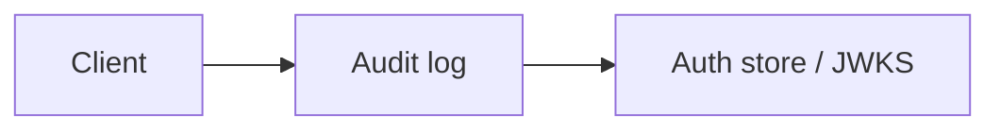

# Audit log

Structured auth events Module: `src/aauth/audit.py`.

## 1. Purpose

Structured auth events Built for Northglass Financial Services (fictional).

## 2. Architecture



## 3. How it works

See `src/aauth/audit.py` and the tests under `tests/`.

## 4. Key files

| File | Role |
|---|---|
| `src/aauth/audit.py` | Implementation |
| `tests/` | Behaviour and attack coverage |

## 5. Code excerpts

<!-- code: src/aauth/audit.py::AuditLog -->
```python
class AuditLog:
    def __init__(self) -> None:
        self.events: list[AuditEvent] = []

    def emit(self, event: str, outcome: str, **kwargs: Any) -> AuditEvent:
        e = AuditEvent(event=event, outcome=outcome, **kwargs)
        self.events.append(e)
        return e

    def by_event(self, name: str) -> list[AuditEvent]:
        return [e for e in self.events if e.event == name]

    def failures(self) -> list[AuditEvent]:
        return [e for e in self.events if e.outcome == "failure"]

    def dumps(self) -> str:
        return "\n".join(json.dumps(e.to_dict(), sort_keys=True) for e in self.events)
```
<!-- /code -->

## 6. Configuration

Defaults live in the module and in `config/policy.yaml`.

## 7. Commands

```bash
aauth soc-export
```

## 8. Real output

<!-- output: soc-export -->
```text
2 alerts in the SecurityAlert shape of Jagadish-azure-ai-soc: High 1, Medium 1
schema problems: 0
example: aauth-0000-demo | Medium | Auth failure: validate_fail (wrong_audience) | techniques T1606 | entity u-ava
```
<!-- /output -->

## 9. Tests and gates

Covered by pytest and `aauth gate`. CI runs both.

## 10. Guardrails

Fail closed on validation errors. Naive paths are never default.

## 11. Security and governance

Mapped in [threat-model.md](../threat-model.md). Keys are runtime-only.

## 12. Observability

Failures emit audit events; see [observability.md](../observability.md).

## 13. Failure modes

See [failure-modes.md](../failure-modes.md).

## 14. Mapping to cloud services

| Azure | Google Cloud | AWS |
|---|---|---|
| Entra ID | Identity Platform | IAM Identity Center |
| API Management | Apigee | API Gateway |
| Key Vault | Cloud KMS | KMS |
| Log Analytics | Cloud Logging | CloudWatch |

Also referenced: Entra ID, API Management, Key Vault, Log Analytics, Microsoft Fabric (N/A here), BigQuery (N/A), S3 (N/A).

## 15. Limitations

Offline demo; Entra path written not run; nothing deployed.

## 16. Interview talking points

Explain how audit log fits the end-to-end agent auth story and cite a real number from `aauth benchmark` or `aauth attacks`.
