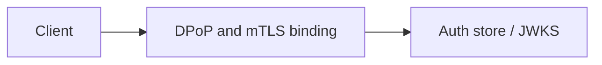

# DPoP and mTLS binding

Sender-constrained access tokens Module: `src/aauth/dpop.py`.

## 1. Purpose

Sender-constrained access tokens Built for Northglass Financial Services (fictional).

## 2. Architecture



## 3. How it works

See `src/aauth/dpop.py` and the tests under `tests/`.

## 4. Key files

| File | Role |
|---|---|
| `src/aauth/dpop.py` | Implementation |
| `tests/` | Behaviour and attack coverage |

## 5. Code excerpts

<!-- code: src/aauth/dpop.py::proof -->
```python
def proof(key: DPoPKey, *, method: str, url: str, access_token: str | None = None, now: int | None = None) -> str:
    """Build a DPoP proof JWT for the given request."""
    ts = now if now is not None else int(time.time())
    claims = {"htu": url, "htm": method.upper(), "iat": ts, "jti": uuid.uuid4().hex}
    if access_token is not None:
        claims["ath"] = _b64u(hashlib.sha256(access_token.encode()).digest())
    headers = {"typ": "dpop+jwt", "alg": "ES256", "jwk": key.public_jwk}
    return jwt.encode(claims, key.private_pem, algorithm="ES256", headers=headers)
```
<!-- /code -->

## 6. Configuration

Defaults live in the module and in `config/policy.yaml`.

## 7. Commands

```bash
aauth attacks
```

## 8. Real output

<!-- output: attacks -->
```text
| Attack | Hardened | Naive (labelled, never default) | Detail |
|---|---|---|---|
| alg=none | blocked:alg_not_allowed:none | accepted | unsigned token |
| RS256-to-HS256 key confusion | blocked:alg_not_allowed:HS256 | accepted | HMAC with RSA public key |
| kid injection / path traversal | blocked:unknown_kid | n/a (no file-based kid) | kid must exist in JWKS |
| jku/x5u spoofing | blocked:unknown_kid | n/a | JWKS is local; jku/x5u headers ignored |
| expired token | blocked:expired | n/a | exp enforced with skew |
| revoked / replayed jti | blocked:revoked | n/a | denylist |
| wrong audience | blocked:wrong_audience | accepted | aud check |
| tampered payload | blocked:bad_signature | n/a | signature covers payload |
| weak HMAC brute force | blocked:RS256_only | accepted:secret=passwordpasswordpasswordpassword | wordlist size 5 |
| stolen bearer without DPoP | blocked:dpop_malformed | n/a | cnf.jkt + proof required |
| refresh token reuse | blocked:reuse_detected | n/a | family revoked on reuse |
| CSRF | blocked:csrf_mismatch | n/a | double-submit CSRF token |
| session fixation | blocked:new_sid | n/a | sid rotated on login |
| JWT in localStorage (XSS exfil) | blocked:by_design_BFF_cookies | accepted:if_stored_in_localStorage | Decision guide: prefer BFF + HttpOnly cookies for SPAs |

hardened blocked 14/14
```
<!-- /output -->

## 9. Tests and gates

Covered by pytest and `aauth gate`. CI runs both.

## 10. Guardrails

Fail closed on validation errors. Naive paths are never default.

## 11. Security and governance

Mapped in [threat-model.md](../threat-model.md). Keys are runtime-only.

## 12. Observability

Failures emit audit events; see [observability.md](../observability.md).

## 13. Failure modes

See [failure-modes.md](../failure-modes.md).

## 14. Mapping to cloud services

| Azure | Google Cloud | AWS |
|---|---|---|
| Entra ID | Identity Platform | IAM Identity Center |
| API Management | Apigee | API Gateway |
| Key Vault | Cloud KMS | KMS |
| Log Analytics | Cloud Logging | CloudWatch |

Also referenced: Entra ID, API Management, Key Vault, Log Analytics, Microsoft Fabric (N/A here), BigQuery (N/A), S3 (N/A).

## 15. Limitations

Offline demo; Entra path written not run; nothing deployed.

## 16. Interview talking points

Explain how dpop and mtls binding fits the end-to-end agent auth story and cite a real number from `aauth benchmark` or `aauth attacks`.
