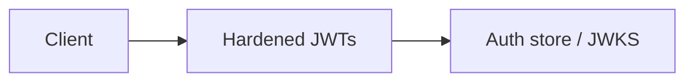

# Hardened JWTs

Short-lived RS256 tokens with tv and denylist Module: `src/aauth/jwt_tokens.py`.

## 1. Purpose

Short-lived RS256 tokens with tv and denylist Built for Northglass Financial Services (fictional).

## 2. Architecture



## 3. How it works

See `src/aauth/jwt_tokens.py` and the tests under `tests/`.

## 4. Key files

| File | Role |
|---|---|
| `src/aauth/jwt_tokens.py` | Implementation |
| `tests/` | Behaviour and attack coverage |

## 5. Code excerpts

<!-- code: src/aauth/jwt_tokens.py::verify -->
```python
def verify(
    token: str,
    ring: KeyRing,
    *,
    audience: str,
    store: AuthStore | None = None,
    require_cnf: str | None = None,
) -> dict:
    """Strict verification. Raises TokenError with a machine-readable reason."""
    try:
        header = jwt.get_unverified_header(token)
    except jwt.PyJWTError as e:
        raise TokenError("malformed_header") from e
    alg = header.get("alg")
    if alg not in ALLOWED_ALGS:
        raise TokenError(f"alg_not_allowed:{alg}")
    kid = header.get("kid")
    if not kid:
        raise TokenError("missing_kid")
    key = ring.by_kid(kid)
    if key is None:
        raise TokenError("unknown_kid")
    try:
        claims = jwt.decode(
            token,
            key.public_pem,
            algorithms=list(ALLOWED_ALGS),
            audience=audience,
            issuer=ring.issuer,
            leeway=CLOCK_SKEW,
            options={"require": ["exp", "iat", "nbf", "iss", "aud", "sub", "jti"]},
        )
    except jwt.ExpiredSignatureError as e:
        raise TokenError("expired") from e
    except jwt.InvalidAudienceError as e:
        raise TokenError("wrong_audience") from e
    except jwt.InvalidIssuerError as e:
        raise TokenError("wrong_issuer") from e
    except jwt.ImmatureSignatureError as e:
        raise TokenError("not_yet_valid") from e
    except jwt.InvalidSignatureError as e:
        raise TokenError("bad_signature") from e
    except jwt.PyJWTError as e:
        raise TokenError(f"invalid:{type(e).__name__}") from e
    if store is not None:
        if store.is_denied(claims["jti"]):
            raise TokenError("revoked")
        expected_tv = store.version(claims["sub"])
        if int(claims.get("tv", -1)) != expected_tv:
            raise TokenError("stale_token_version")
    if require_cnf:
        cnf = claims.get("cnf") or {}
        if require_cnf not in cnf:
            raise TokenError(f"missing_cnf:{require_cnf}")
    return claims
```
<!-- /code -->

## 6. Configuration

Defaults live in the module and in `config/policy.yaml`.

## 7. Commands

```bash
aauth gate
```

## 8. Real output

<!-- output: gate -->
```text
Auth security release gate

PASS  jwks_active_key: 1 keys
PASS  attack_suite_hardened: 14/14 blocked
PASS  delegation_blocks_overreach: no_overlapping_scopes
PASS  delegation_subset: exceeded=[]
PASS  benchmark_runs: measured ok
PASS  naive_not_in_default_paths: offenders=[]

6/6 checks passed
```
<!-- /output -->

## 9. Tests and gates

Covered by pytest and `aauth gate`. CI runs both.

## 10. Guardrails

Fail closed on validation errors. Naive paths are never default.

## 11. Security and governance

Mapped in [threat-model.md](../threat-model.md). Keys are runtime-only.

## 12. Observability

Failures emit audit events; see [observability.md](../observability.md).

## 13. Failure modes

See [failure-modes.md](../failure-modes.md).

## 14. Mapping to cloud services

| Azure | Google Cloud | AWS |
|---|---|---|
| Entra ID | Identity Platform | IAM Identity Center |
| API Management | Apigee | API Gateway |
| Key Vault | Cloud KMS | KMS |
| Log Analytics | Cloud Logging | CloudWatch |

Also referenced: Entra ID, API Management, Key Vault, Log Analytics, Microsoft Fabric (N/A here), BigQuery (N/A), S3 (N/A).

## 15. Limitations

Offline demo; Entra path written not run; nothing deployed.

## 16. Interview talking points

Explain how hardened jwts fits the end-to-end agent auth story and cite a real number from `aauth benchmark` or `aauth attacks`.
