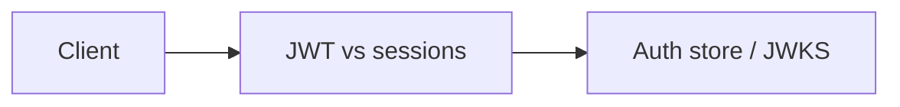

# JWT vs sessions

The article comparison, measured Module: `src/aauth/benchmark.py`.

## 1. Purpose

The article comparison, measured Built for Northglass Financial Services (fictional).

## 2. Architecture



## 3. How it works

See `src/aauth/benchmark.py` and the tests under `tests/`.

## 4. Key files

| File | Role |
|---|---|
| `src/aauth/benchmark.py` | Implementation |
| `tests/` | Behaviour and attack coverage |

## 5. Code excerpts

<!-- code: src/aauth/benchmark.py::measure -->
```python
def measure(iterations: int = 200, redis: bool = False) -> dict:
    ring = KeyRing.create(COMPANY.issuer, seed=7)
    store = AuthStore.redis() if redis else AuthStore.memory()
    sub, roles, scopes = "u-ava", ["loan.officer"], ["loans:read", "loans:write", "docs:read"]

    # Warm up key + one token/session.
    tok = jwt_tokens.issue(ring, sub=sub, audience=COMPANY.audience_api, scopes=scopes, roles=roles, store=store)
    sess = sessions.create(store, sub=sub, roles=roles, scopes=scopes)

    # --- verification latency ---
    jwt_lat: list[float] = []
    for _ in range(iterations):
        t0 = time.perf_counter()
        jwt_tokens.verify(tok.token, ring, audience=COMPANY.audience_api, store=store)
        jwt_lat.append((time.perf_counter() - t0) * 1000)
    sess_lat: list[float] = []
    for _ in range(iterations):
        t0 = time.perf_counter()
        sessions.load(store, sess.sid)
        sess_lat.append((time.perf_counter() - t0) * 1000)

    # --- throughput (ops in 0.25s) ---
    def throughput(fn, seconds=0.25) -> float:
        n, end = 0, time.perf_counter() + seconds
        while time.perf_counter() < end:
            fn()
            n += 1
        return n / seconds

    jwt_tps = throughput(lambda: jwt_tokens.verify(tok.token, ring, audience=COMPANY.audience_api, store=store))
    sess_tps = throughput(lambda: sessions.load(store, sess.sid))

    # --- time-to-revocation ---
    # JWT: deny jti, next verify fails. Session: delete sid, next load fails.
    t0 = time.perf_counter()
    jwt_tokens.revoke(store, tok.jti, remaining_ttl=300)
    try:
        jwt_tokens.verify(tok.token, ring, audience=COMPANY.audience_api, store=store)
        jwt_rev_ms = -1.0
    except jwt_tokens.TokenError as e:
        jwt_rev_ms = (time.perf_counter() - t0) * 1000
        assert e.reason == "revoked"
    t0 = time.perf_counter()
    sessions.destroy(store, sess.sid)
    try:
        sessions.load(store, sess.sid)
        sess_rev_ms = -1.0
    except sessions.SessionError:
        sess_rev_ms = (time.perf_counter() - t0) * 1000

    # Fresh pair for the remaining tests.
    tok = jwt_tokens.issue(ring, sub=sub, audience=COMPANY.audience_api, scopes=scopes, roles=roles, store=store)
    sess = sessions.create(store, sub=sub, roles=roles, scopes=scopes)

    # --- stale-claims window after a role change ---
    # JWT: until ttl/version bump, old token still has old roles (we bump tv so verify fails).
    # Session: update_roles takes effect on next load.
    store.bump_version(sub)
    jwt_stale = "immediate reject after tv bump (else up to access-token TTL)"
    sessions.update_roles(store, sess.sid, roles=["loan.underwriter"], scopes=["loans:read", "loans:decide"])
    updated = sessions.load(store, sess.sid)
    sess_stale = "next request sees new roles" if "loan.underwriter" in updated.roles else "FAILED"

    # --- payload visibility ---
    claims = jwt_tokens.decode_unverified(tok.token)
    jwt_visible = f"claims readable without key (sub={claims['sub']}, roles={claims.get('roles')})"
    sess_visible = "opaque sid; data only in server store"

    # --- scaling across N instances ---
    # JWT verifies locally on each instance. Session needs shared store (we simulate N lookups).
    n_instances = 5
    t0 = time.perf_counter()
    for _ in range(n_instances):
        # each "instance" has the JWKS (public keys) and verifies locally
        jwt_tokens.verify(
            jwt_tokens.issue(ring, sub=sub, audience=COMPANY.audience_api, scopes=scopes, roles=roles, store=store).token,
            ring,
            audience=COMPANY.audience_api,
            store=store,
        )
    jwt_scale_ms = (time.perf_counter() - t0) * 1000
    t0 = time.perf_counter()
    for _ in range(n_instances):
        sessions.load(store, sess.sid)
    sess_scale_ms = (time.perf_counter() - t0) * 1000

    store_label = "fakeredis" if redis else "in-memory dict"
    return {
        "iterations": iterations,
        "store": store_label,
        "jwt_verify_p50_ms": round(_pct(jwt_lat, 50), 4),
        "jwt_verify_p95_ms": round(_pct(jwt_lat, 95), 4),
        "session_lookup_p50_ms": round(_pct(sess_lat, 50), 4),
        "session_lookup_p95_ms": round(_pct(sess_lat, 95), 4),
        "jwt_throughput_ops": int(jwt_tps),
        "session_throughput_ops": int(sess_tps),
        "jwt_revoke_ms": round(jwt_rev_ms, 4),
        "session_revoke_ms": round(sess_rev_ms, 4),
        "jwt_stale_claims": jwt_stale,
        "session_stale_claims": sess_stale,
        "jwt_payload_visibility": jwt_visible,
        "session_payload_visibility": sess_visible,
        "jwt_multi_instance_ms": round(jwt_scale_ms, 4),
        "session_multi_instance_ms": round(sess_scale_ms, 4),
        "n_instances": n_instances,
        "jwt_mean_ms": round(statistics.mean(jwt_lat), 4),
        "session_mean_ms": round(statistics.mean(sess_lat), 4),
    }
```
<!-- /code -->

## 6. Configuration

Defaults live in the module and in `config/policy.yaml`.

## 7. Commands

```bash
aauth benchmark --iterations 80
```

## 8. Real output

<!-- output: benchmark --evidence evidence/benchmark.json -->
```text
Store: in-memory dict; iterations: 80; host microbench (not a capacity plan).

| Dimension | JWT (stateless-ish) | Server session (stateful) | Notes |
|---|---|---|---|
| Scalability | Local verify; no shared store required for authZ check | Needs shared session store across 5+ instances | JWT still needs a denylist/version store for revocation |
| Performance (p50 verify) | 0.1085 ms (8772 ops/s) | 0.0077 ms (129248 ops/s) | Store=in-memory dict; single-process microbench |
| Revocation | Denylist hit in 0.441 ms | Delete sid in 0.0099 ms | Without a denylist, JWT revocation waits for TTL |
| Session / claim updates | immediate reject after tv bump (else up to access-token TTL) | next request sees new roles | Token version (tv) claim closes the JWT stale window |
| Data security | claims readable without key (sub=u-ava, roles=['loan.officer']) | opaque sid; data only in server store | JWTs are signed, not encrypted; keep PII out of claims (or use JWE) |
| Implementation complexity | JWKS, rotation, denylist, DPoP optional | Cookie flags, CSRF, fixation, idle/absolute TTL | Both need careful hardening |
| Best for | APIs, SPAs via BFF, service-to-service, agents | Server-rendered apps, simple sticky sessions | See docs/decision-guide.md |
| Avoid if | You cannot run a revocation/version store and need instant kill | You need pure horizontal scale with no shared store | Measured on this host; re-run with `aauth benchmark` |
```
<!-- /output -->

## 9. Tests and gates

Covered by pytest and `aauth gate`. CI runs both.

## 10. Guardrails

Fail closed on validation errors. Naive paths are never default.

## 11. Security and governance

Mapped in [threat-model.md](../threat-model.md). Keys are runtime-only.

## 12. Observability

Failures emit audit events; see [observability.md](../observability.md).

## 13. Failure modes

See [failure-modes.md](../failure-modes.md).

## 14. Mapping to cloud services

| Azure | Google Cloud | AWS |
|---|---|---|
| Entra ID | Identity Platform | IAM Identity Center |
| API Management | Apigee | API Gateway |
| Key Vault | Cloud KMS | KMS |
| Log Analytics | Cloud Logging | CloudWatch |

Also referenced: Entra ID, API Management, Key Vault, Log Analytics, Microsoft Fabric (N/A here), BigQuery (N/A), S3 (N/A).

## 15. Limitations

Offline demo; Entra path written not run; nothing deployed.

## 16. Interview talking points

Explain how jwt vs sessions fits the end-to-end agent auth story and cite a real number from `aauth benchmark` or `aauth attacks`.
