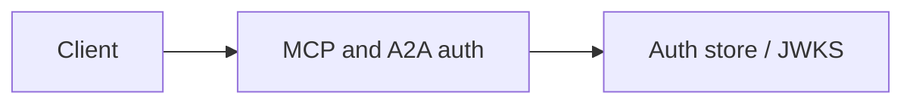

# MCP and A2A auth

No passthrough; peer allow-lists Module: `src/aauth/mcp_auth.py`.

## 1. Purpose

No passthrough; peer allow-lists Built for Northglass Financial Services (fictional).

## 2. Architecture



## 3. How it works

See `src/aauth/mcp_auth.py` and the tests under `tests/`.

## 4. Key files

| File | Role |
|---|---|
| `src/aauth/mcp_auth.py` | Implementation |
| `tests/` | Behaviour and attack coverage |

## 5. Code excerpts

<!-- code: src/aauth/mcp_auth.py::build_demo_mcp -->
```python
def build_demo_mcp(ring: KeyRing, store: AuthStore) -> MCPAuth:
    return MCPAuth(
        ring=ring,
        store=store,
        resource=MCPResource(
            resource="https://mcp.northglass.example",
            audience=COMPANY.audience_mcp,
            authorization_servers=[COMPANY.issuer],
            scopes_supported=["tools:summarize", "tools:fetch", "tools:screen", "docs:read", "loans:read"],
        ),
        tool_scopes={
            "summarize_loan": ["tools:summarize", "loans:read"],
            "fetch_document": ["tools:fetch", "docs:read"],
            "screen_risk": ["tools:screen", "loans:read"],
        },
    )
```
<!-- /code -->

## 6. Configuration

Defaults live in the module and in `config/policy.yaml`.

## 7. Commands

```bash
aauth gate
```

## 8. Real output

<!-- output: gate -->
```text
Auth security release gate

PASS  jwks_active_key: 1 keys
PASS  attack_suite_hardened: 14/14 blocked
PASS  delegation_blocks_overreach: no_overlapping_scopes
PASS  delegation_subset: exceeded=[]
PASS  benchmark_runs: jwt_p50=0.1133
PASS  naive_not_in_default_paths: offenders=[]

6/6 checks passed
```
<!-- /output -->

## 9. Tests and gates

Covered by pytest and `aauth gate`. CI runs both.

## 10. Guardrails

Fail closed on validation errors. Naive paths are never default.

## 11. Security and governance

Mapped in [threat-model.md](../threat-model.md). Keys are runtime-only.

## 12. Observability

Failures emit audit events; see [observability.md](../observability.md).

## 13. Failure modes

See [failure-modes.md](../failure-modes.md).

## 14. Mapping to cloud services

| Azure | Google Cloud | AWS |
|---|---|---|
| Entra ID | Identity Platform | IAM Identity Center |
| API Management | Apigee | API Gateway |
| Key Vault | Cloud KMS | KMS |
| Log Analytics | Cloud Logging | CloudWatch |

Also referenced: Entra ID, API Management, Key Vault, Log Analytics, Microsoft Fabric (N/A here), BigQuery (N/A), S3 (N/A).

## 15. Limitations

Offline demo; Entra path written not run; nothing deployed.

## 16. Interview talking points

Explain how mcp and a2a auth fits the end-to-end agent auth story and cite a real number from `aauth benchmark` or `aauth attacks`.
