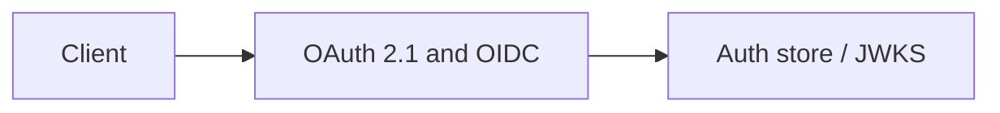

# OAuth 2.1 and OIDC

PKCE, client credentials, introspection Module: `src/aauth/oauth_server.py`.

## 1. Purpose

PKCE, client credentials, introspection Built for Northglass Financial Services (fictional).

## 2. Architecture



## 3. How it works

See `src/aauth/oauth_server.py` and the tests under `tests/`.

## 4. Key files

| File | Role |
|---|---|
| `src/aauth/oauth_server.py` | Implementation |
| `tests/` | Behaviour and attack coverage |

## 5. Code excerpts

<!-- code: src/aauth/oauth_server.py::build_demo_server -->
```python
def build_demo_server(ring: KeyRing, store: AuthStore) -> OAuthServer:
    srv = OAuthServer(ring=ring, store=store)
    srv.register_client(
        Client(
            client_id="spa-loan-portal",
            client_conf=None,
            redirect_uris=["https://loans.northglass.example/callback"],
            grant_types=["authorization_code", "refresh_token"],
            scopes=["loans:read", "loans:write", "docs:read", "openid", "profile"],
            audience=COMPANY.audience_api,
        )
    )
    srv.register_client(
        Client(
            client_id="svc-batch",
            client_conf="demo-only-not-a-real-secret",
            redirect_uris=[],
            grant_types=["client_credentials"],
            scopes=["loans:read", "docs:read"],
            audience=COMPANY.audience_api,
        )
    )
    for p in COMPANY.principals.values():
        if p.kind == "user":
            srv.register_user(p.id, password=f"pass-{p.id}", roles=list(p.roles), scopes=[*list(p.scopes), "openid", "profile"])
    return srv
```
<!-- /code -->

## 6. Configuration

Defaults live in the module and in `config/policy.yaml`.

## 7. Commands

```bash
aauth company
```

## 8. Real output

<!-- output: company -->
```text
Northglass Financial Services (northglass)
issuer: https://auth.northglass.example
principals: 8
  u-ava    user    Ava Chen             roles=loan.officer
  u-ben    user    Ben Okonkwo          roles=loan.underwriter
  u-cara   user    Cara Singh           roles=compliance.officer
  u-dev    user    Dev Patel            roles=it.admin
  a-loan   agent   Loan Assistant       roles=agent.loan_assistant
  a-docs   agent   Doc Fetcher          roles=agent.doc_fetcher
  a-risk   agent   Risk Screener        roles=agent.risk_screener
  s-apim   service APIM Gateway         roles=service.apim
```
<!-- /output -->

## 9. Tests and gates

Covered by pytest and `aauth gate`. CI runs both.

## 10. Guardrails

Fail closed on validation errors. Naive paths are never default.

## 11. Security and governance

Mapped in [threat-model.md](../threat-model.md). Keys are runtime-only.

## 12. Observability

Failures emit audit events; see [observability.md](../observability.md).

## 13. Failure modes

See [failure-modes.md](../failure-modes.md).

## 14. Mapping to cloud services

| Azure | Google Cloud | AWS |
|---|---|---|
| Entra ID | Identity Platform | IAM Identity Center |
| API Management | Apigee | API Gateway |
| Key Vault | Cloud KMS | KMS |
| Log Analytics | Cloud Logging | CloudWatch |

Also referenced: Entra ID, API Management, Key Vault, Log Analytics, Microsoft Fabric (N/A here), BigQuery (N/A), S3 (N/A).

## 15. Limitations

Offline demo; Entra path written not run; nothing deployed.

## 16. Interview talking points

Explain how oauth 2.1 and oidc fits the end-to-end agent auth story and cite a real number from `aauth benchmark` or `aauth attacks`.
