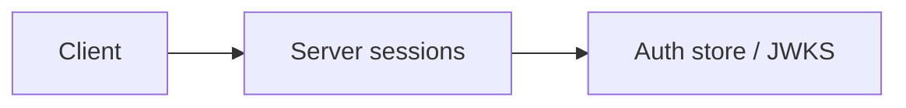

# Server sessions

HttpOnly cookies, CSRF, fixation, timeouts Module: `src/aauth/sessions.py`.

## 1. Purpose

HttpOnly cookies, CSRF, fixation, timeouts Built for Northglass Financial Services (fictional).

## 2. Architecture



## 3. How it works

See `src/aauth/sessions.py` and the tests under `tests/`.

## 4. Key files

| File | Role |
|---|---|
| `src/aauth/sessions.py` | Implementation |
| `tests/` | Behaviour and attack coverage |

## 5. Code excerpts

<!-- code: src/aauth/sessions.py::create -->
```python
def create(store: AuthStore, *, sub: str, roles: list[str], scopes: list[str], now: float | None = None) -> Session:
    """Create a new session. Always generates a fresh sid (fixation defence)."""
    ts = now if now is not None else time.time()
    sid = secrets.token_urlsafe(32)
    csrf = secrets.token_urlsafe(32)
    sess = Session(sid=sid, sub=sub, roles=roles, scopes=scopes, csrf=csrf, created_at=ts, last_seen=ts, absolute_exp=ts + ABSOLUTE_TTL)
    store.put_session(sid, sess.to_dict(), ttl=IDLE_TTL)
    return sess
```
<!-- /code -->

## 6. Configuration

Defaults live in the module and in `config/policy.yaml`.

## 7. Commands

```bash
aauth company
```

## 8. Real output

<!-- output: company -->
```text
Northglass Financial Services (northglass)
issuer: https://auth.northglass.example
principals: 8
  u-ava    user    Ava Chen             roles=loan.officer
  u-ben    user    Ben Okonkwo          roles=loan.underwriter
  u-cara   user    Cara Singh           roles=compliance.officer
  u-dev    user    Dev Patel            roles=it.admin
  a-loan   agent   Loan Assistant       roles=agent.loan_assistant
  a-docs   agent   Doc Fetcher          roles=agent.doc_fetcher
  a-risk   agent   Risk Screener        roles=agent.risk_screener
  s-apim   service APIM Gateway         roles=service.apim
```
<!-- /output -->

## 9. Tests and gates

Covered by pytest and `aauth gate`. CI runs both.

## 10. Guardrails

Fail closed on validation errors. Naive paths are never default.

## 11. Security and governance

Mapped in [threat-model.md](../threat-model.md). Keys are runtime-only.

## 12. Observability

Failures emit audit events; see [observability.md](../observability.md).

## 13. Failure modes

See [failure-modes.md](../failure-modes.md).

## 14. Mapping to cloud services

| Azure | Google Cloud | AWS |
|---|---|---|
| Entra ID | Identity Platform | IAM Identity Center |
| API Management | Apigee | API Gateway |
| Key Vault | Cloud KMS | KMS |
| Log Analytics | Cloud Logging | CloudWatch |

Also referenced: Entra ID, API Management, Key Vault, Log Analytics, Microsoft Fabric (N/A here), BigQuery (N/A), S3 (N/A).

## 15. Limitations

Offline demo; Entra path written not run; nothing deployed.

## 16. Interview talking points

Explain how server sessions fits the end-to-end agent auth story and cite a real number from `aauth benchmark` or `aauth attacks`.
