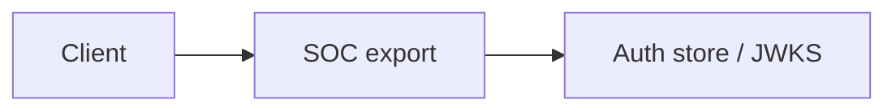

# SOC export

SecurityAlert rows for the SOC repo Module: `src/aauth/soc.py`.

## 1. Purpose

SecurityAlert rows for the SOC repo Built for Northglass Financial Services (fictional).

## 2. Architecture



## 3. How it works

See `src/aauth/soc.py` and the tests under `tests/`.

## 4. Key files

| File | Role |
|---|---|
| `src/aauth/soc.py` | Implementation |
| `tests/` | Behaviour and attack coverage |

## 5. Code excerpts

<!-- code: src/aauth/soc.py::export -->
```python
def export(log: AuditLog, now: datetime | None = None) -> list[dict]:
    ts = (now or datetime.now(UTC)).strftime("%Y-%m-%dT%H:%M:%SZ")
    rows = []
    for i, e in enumerate(log.failures()):
        reason = e.reason or e.event
        techniques = list(TECHNIQUES.get(reason.split(":")[0], []))
        tactics = sorted({t for tech in techniques for t in TACTICS.get(tech, [])})
        rows.append(
            {
                "TimeGenerated": ts,
                "SystemAlertId": f"aauth-{i:04d}-{e.token_id or e.subject or 'anon'}"[:64],
                "AlertName": f"Auth failure: {e.event} ({reason})",
                "ProductName": PRODUCT,
                "ProviderName": PRODUCT,
                "AlertSeverity": SEVERITY.get(reason.split(":")[0], "Low"),
                "Techniques": techniques,
                "Tactics": tactics,
                "Entities": [{"Type": "account", "Name": e.subject or "unknown"}],
                "Description": f"Auth event {e.event} failed: {reason}. client={e.client_id or '-'}",
                "EventIds": [],
                "ExtendedProperties": {"event": e.event, "reason": reason, "scopes": e.scopes},
            }
        )
    return rows
```
<!-- /code -->

## 6. Configuration

Defaults live in the module and in `config/policy.yaml`.

## 7. Commands

```bash
aauth soc-export
```

## 8. Real output

<!-- output: soc-export -->
```text
2 alerts in the SecurityAlert shape of Jagadish-azure-ai-soc: High 1, Medium 1
schema problems: 0
example: aauth-0000-demo | Medium | Auth failure: validate_fail (wrong_audience) | techniques T1606 | entity u-ava
```
<!-- /output -->

## 9. Tests and gates

Covered by pytest and `aauth gate`. CI runs both.

## 10. Guardrails

Fail closed on validation errors. Naive paths are never default.

## 11. Security and governance

Mapped in [threat-model.md](../threat-model.md). Keys are runtime-only.

## 12. Observability

Failures emit audit events; see [observability.md](../observability.md).

## 13. Failure modes

See [failure-modes.md](../failure-modes.md).

## 14. Mapping to cloud services

| Azure | Google Cloud | AWS |
|---|---|---|
| Entra ID | Identity Platform | IAM Identity Center |
| API Management | Apigee | API Gateway |
| Key Vault | Cloud KMS | KMS |
| Log Analytics | Cloud Logging | CloudWatch |

Also referenced: Entra ID, API Management, Key Vault, Log Analytics, Microsoft Fabric (N/A here), BigQuery (N/A), S3 (N/A).

## 15. Limitations

Offline demo; Entra path written not run; nothing deployed.

## 16. Interview talking points

Explain how soc export fits the end-to-end agent auth story and cite a real number from `aauth benchmark` or `aauth attacks`.
