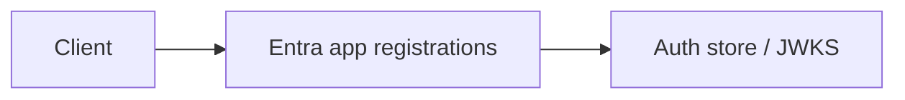

# Entra app registrations

App roles, PKCE portal, agent apps Module: `src/aauth/entra.py`.

## 1. Purpose

App roles, PKCE portal, agent apps Built for Northglass Financial Services (fictional).

## 2. Architecture



## 3. How it works

See `src/aauth/entra.py` and the tests under `tests/`.

## 4. Key files

| File | Role |
|---|---|
| `src/aauth/entra.py` | Implementation |
| `tests/` | Behaviour and attack coverage |

## 5. Code excerpts

<!-- code: src/aauth/entra.py::APP_REGISTRATION_NOTES -->
```python
APP_REGISTRATION_NOTES = """
Entra app registration (documented, not applied from this repo):

1. Register "northglass-loan-api" as a single-tenant app. Expose an API with scopes
   loans.read, loans.write, docs.read, credit.read. Create app roles loan.officer,
   loan.underwriter, compliance.officer, it.admin, agent.loan_assistant.
2. Register "northglass-loan-portal" as a public client (SPA) with redirect URI
   https://loans.northglass.example/callback. Enable auth code + PKCE. Grant the API scopes.
3. Register each agent as an application with a federated credential (no secret) and
   assign the agent.* app roles. For OBO, add knownClientApplications and expose
   the agent as an authorized client of the API.
4. Conditional Access: require MFA for interactive users; block legacy auth; require
   compliant device for admin roles. Agents use workload identity, not user CA.
5. APIM validate-azure-ad-token policy pins the tenant, audience and required roles.
"""
```
<!-- /code -->

## 6. Configuration

Defaults live in the module and in `config/policy.yaml`.

## 7. Commands

```bash
aauth company
```

## 8. Real output

<!-- output: company -->
```text
Northglass Financial Services (northglass)
issuer: https://auth.northglass.example
principals: 8
  u-ava    user    Ava Chen             roles=loan.officer
  u-ben    user    Ben Okonkwo          roles=loan.underwriter
  u-cara   user    Cara Singh           roles=compliance.officer
  u-dev    user    Dev Patel            roles=it.admin
  a-loan   agent   Loan Assistant       roles=agent.loan_assistant
  a-docs   agent   Doc Fetcher          roles=agent.doc_fetcher
  a-risk   agent   Risk Screener        roles=agent.risk_screener
  s-apim   service APIM Gateway         roles=service.apim
```
<!-- /output -->

## 9. Tests and gates

Covered by pytest and `aauth gate`. CI runs both.

## 10. Guardrails

Fail closed on validation errors. Naive paths are never default.

## 11. Security and governance

Mapped in [threat-model.md](../threat-model.md). Keys are runtime-only.

## 12. Observability

Failures emit audit events; see [observability.md](../observability.md).

## 13. Failure modes

See [failure-modes.md](../failure-modes.md).

## 14. Mapping to cloud services

| Azure | Google Cloud | AWS |
|---|---|---|
| Entra ID | Identity Platform | IAM Identity Center |
| API Management | Apigee | API Gateway |
| Key Vault | Cloud KMS | KMS |
| Log Analytics | Cloud Logging | CloudWatch |

Also referenced: Entra ID, API Management, Key Vault, Log Analytics, Microsoft Fabric (N/A here), BigQuery (N/A), S3 (N/A).

## 15. Limitations

Offline demo; Entra path written not run; nothing deployed.

## 16. Interview talking points

Explain how entra app registrations fits the end-to-end agent auth story and cite a real number from `aauth benchmark` or `aauth attacks`.
