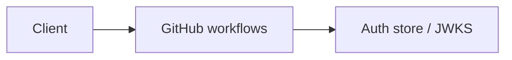

# GitHub workflows

SHA-pinned CI, gated deploy, CodeQL, gitleaks Module: `src/aauth/iac.py`.

## 1. Purpose

SHA-pinned CI, gated deploy, CodeQL, gitleaks Built for Northglass Financial Services (fictional).

## 2. Architecture



## 3. How it works

See `src/aauth/iac.py` and the tests under `tests/`.

## 4. Key files

| File | Role |
|---|---|
| `src/aauth/iac.py` | Implementation |
| `tests/` | Behaviour and attack coverage |

## 5. Code excerpts

<!-- code: src/aauth/iac.py::workflows -->
```python
def workflows() -> list[dict]:
    out = []
    if not WF.exists():
        return out
    for p in sorted(WF.glob("*.yml")):
        d = yaml.safe_load(p.read_text())
        text = p.read_text()
        actions = [ln for ln in text.splitlines() if "uses:" in ln and not ln.strip().startswith("#")]
        pinned = [ln for ln in actions if SHA_PIN.search(ln)]
        out.append(
            {
                "workflow": p.name,
                "read_only": d.get("permissions") == {"contents": "read"},
                "actions": len(actions),
                "pinned": len(pinned),
                "gated": text.count("DEPLOY_ENABLED"),
                "oidc": text.count("id-token"),
            }
        )
    return out
```
<!-- /code -->

## 6. Configuration

Defaults live in the module and in `config/policy.yaml`.

## 7. Commands

```bash
aauth iac
```

## 8. Real output

<!-- output: iac -->
```text
terraform resources: 9; controls: {'key_vault': True, 'entra_apps': True, 'apim': True, 'log_analytics': True, 'no_secrets': True, 'rbac_kv': True}; test runs: 3
bicep files: 2; controls: {'key_vault': True, 'apim': True, 'log_analytics': True, 'validate_token': True}
workflow ci.yml: read_only=True pinned=8/8 gated=0
workflow codeql.yml: read_only=True pinned=3/3 gated=0
workflow deploy.yml: read_only=True pinned=6/6 gated=5
workflow infra.yml: read_only=True pinned=9/9 gated=0
workflow teardown.yml: read_only=True pinned=3/3 gated=1
controls_ok: True
```
<!-- /output -->

## 9. Tests and gates

Covered by pytest and `aauth gate`. CI runs both.

## 10. Guardrails

Fail closed on validation errors. Naive paths are never default.

## 11. Security and governance

Mapped in [threat-model.md](../threat-model.md). Keys are runtime-only.

## 12. Observability

Failures emit audit events; see [observability.md](../observability.md).

## 13. Failure modes

See [failure-modes.md](../failure-modes.md).

## 14. Mapping to cloud services

| Azure | Google Cloud | AWS |
|---|---|---|
| Entra ID | Identity Platform | IAM Identity Center |
| API Management | Apigee | API Gateway |
| Key Vault | Cloud KMS | KMS |
| Log Analytics | Cloud Logging | CloudWatch |

Also referenced: Entra ID, API Management, Key Vault, Log Analytics, Microsoft Fabric (N/A here), BigQuery (N/A), S3 (N/A).

## 15. Limitations

Offline demo; Entra path written not run; nothing deployed.

## 16. Interview talking points

Explain how github workflows fits the end-to-end agent auth story and cite a real number from `aauth benchmark` or `aauth attacks`.
