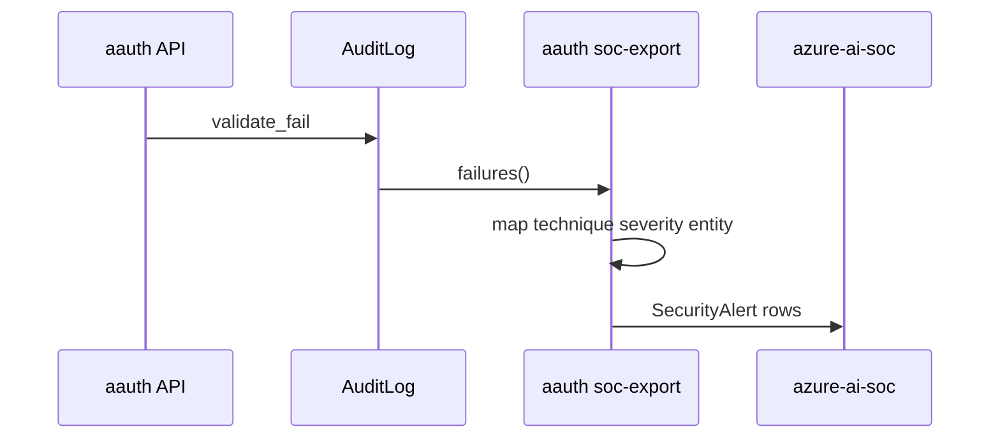

# SOC integration

Auth failures export to the SecurityAlert shape consumed by [Jagadish-azure-ai-soc](https://github.com/jagadishmazure-jpg/Jagadish-azure-ai-soc). Companion posture findings come from [Jagadish-agent-identity-security](https://github.com/jagadishmazure-jpg/Jagadish-agent-identity-security).



## Try it

```bash
aauth soc-export
```
